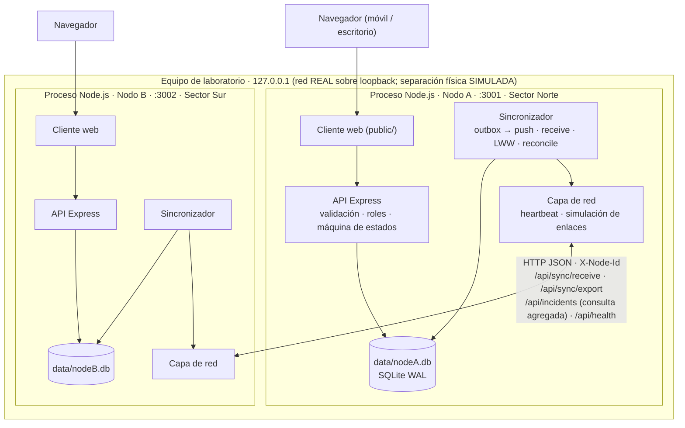

# Manual técnico · Sistema distribuido de alertas y atención de incidentes

> Prototipo académico (UNACH · Licenciatura en Ingeniería en Desarrollo y Tecnologías de Software · Cómputo distribuido RE04 · Laboratorio Integrador 02). **No es un servicio real de emergencias.** Todos los datos, personas y ubicaciones son ficticios.

Contenido:
1. [Arquitectura](#1-arquitectura)
2. [Instalación en un entorno limpio](#2-instalación-en-un-entorno-limpio)
3. [Configuración](#3-configuración)
4. [Ejecución y despliegue](#4-ejecución-y-despliegue)
5. [Administración](#5-administración)
6. [Diagnóstico](#6-diagnóstico)
7. [Recuperación](#7-recuperación)
8. [Seguridad](#8-seguridad)
9. [Trazabilidad de requisitos](#9-trazabilidad-de-requisitos)
10. [Limitaciones y mejoras para un despliegue real](#10-limitaciones-y-mejoras-para-un-despliegue-real)
11. [Preguntas de la defensa](#11-preguntas-de-la-defensa)

Documentos relacionados:
- [REGLAS.md](REGLAS.md) (Fase 1)
- [RED_MESH_MANET.md](RED_MESH_MANET.md) (Fase 2)
- [MODELO_DATOS.md](MODELO_DATOS.md) (Fase 3)
- [API.md](API.md) (Fase 4)
- [SINCRONIZACION.md](SINCRONIZACION.md) (Fase 5)
- [PRUEBAS.md](PRUEBAS.md) (Fase 6)
- [MANUAL_USUARIO.md](MANUAL_USUARIO.md)

---

## 1. Arquitectura

### 1.1 Vista de componentes y despliegue



| Componente | Archivos | Responsabilidad |
|---|---|---|
| Arranque del nodo | `src/server.js`, `src/config.js` | Cargar y validar el entorno, abrir y migrar la BD, montar las rutas, cabeceras de seguridad, iniciar el heartbeat y el sincronizador |
| Persistencia | `src/db/schema.sql`, `migrate.js`, `connection.js`, `tx.js` | Esquema v3, semillas (roles, permisos, usuarios ficticios), WAL, identidad del archivo, transacciones `BEGIN IMMEDIATE` |
| Dominio | `src/domain/rules.js`, `validation.js` | Catálogos, máquina de estados, matriz de permisos, validación estricta con lista blanca |
| Repositorios | `src/repositories/*` | SQL parametrizado: incidentes, bitácora append-only, outbox |
| Servicio de incidentes | `src/services/incidents.service.js` | F-01 a F-04. Cada cambio, en **una** transacción: incidente + bitácora + evento en outbox |
| Sincronización | `src/services/sync.service.js` | Envío de la outbox, recepción idempotente, detección de conflicto por versión base, LWW, reconciliación (pull), `sync_log` |
| Consulta agregada | `src/services/aggregate.service.js` | F-05: fan-out a las particiones, fuentes caídas, réplica local marcada |
| Red | `src/network/netsim.js` | `peerFetch` con timeout, heartbeat, sondeo de latencia, **simulación** de corte, latencia y pérdida, partición simétrica |
| Seguridad | `src/middleware/auth.js`, `localOnly.js`, `errors.js` | X-User → usuario y permisos desde la BD; rutas admin solo por loopback; errores sin trazas |
| Cliente web | `public/` | Tablero, alta, detalle, red y sincronización, bitácora. Sin compilación ni dependencias |
| Scripts | `scripts/` | `start-all`, `connectivity-test`, `kill-node`, `backup`, `restore`, `demo.ps1` |

### 1.2 Decisiones de diseño

| Decisión | Alternativa descartada | Motivo |
|---|---|---|
| Un solo código y dos procesos, configurados por `.env` | Dos proyectos distintos | Reproducibilidad: los nodos difieren solo en la configuración |
| `node:sqlite` (nativo de Node ≥ 22.13) | `better-sqlite3`, `sqlite3` | No requiere compilación nativa en Windows. La única dependencia del proyecto es Express |
| Partición por nodo de origen + replicación completa asíncrona | Partición sin réplica | Permite operar y consultar con un nodo caído (resiliencia). La consulta agregada sigue preguntando en vivo a la fuente autorizada |
| *Transactional outbox* | Enviar al peer dentro de la petición del usuario | La operación del usuario no depende de la red; los eventos sobreviven a caídas y reinicios |
| UUID v4 generado en el origen; event_id = id de bitácora | Autoincremento | Crear sin coordinación; idempotencia y deduplicación naturales |
| Instantánea completa + versión base en cada evento | Enviar solo el cambio (delta) | Aplicación idempotente, detección **precisa** de concurrencia, LWW simple |
| Last Write Wins `(updated_at, updated_node)` | Vector clocks / CRDT | Simple y determinista, adecuado al alcance. Sus límites están documentados |
| Frontend HTML/JS sin compilación | React con build | Cada nodo sirve su UI; menos piezas que explicar en la defensa; CSP estricta |

### 1.3 Flujos principales

- **Alta (F-01):** UI → `POST /api/incidents` → validar → `tx { insert incidente; insert bitácora CREAR; insert outbox(B) }` → `201`, con `sync.state = PENDIENTE`.
- **Replicación (F-07):** cada 3 s, o al detectar `PEER_UP`, se lee la outbox → `POST peer/api/sync/receive` → el peer deduplica, aplica o resuelve el conflicto → responde → se marca `ENTREGADO` y el incidente pasa a `SINCRONIZADO`.
- **Consulta agregada (F-05):** UI → `GET /api/aggregate/incidents` → partición local + `GET peer/api/incidents?node=peer` (reenviando el usuario) → combinación. Si un nodo cae, se informa y se sirve su réplica marcada.
- **Recuperación tras un respaldo antiguo (T-10):** restaurar → arrancar → `POST /api/sync/reconcile` → `GET peer/api/sync/export` → fusión LWW + `INSERT OR IGNORE`.

### 1.4 Puntos de falla y comportamiento

| Falla | Detección | Comportamiento |
|---|---|---|
| Se cae el proceso del peer | `ECONNREFUSED` en el heartbeat o en el envío | Pendientes en outbox; consulta parcial; avisos en la UI; sincronización automática al volver |
| Enlace lento o con pérdida | Timeout (`PEER_TIMEOUT_MS`) o pérdida simulada | Reintento en el siguiente ciclo; el lote solo se marca si el peer confirma |
| Se cae el propio nodo | La UI deja de recibir respuesta | Aviso rojo con enlace a otro nodo; al reiniciar, envía lo pendiente que quedó en disco |
| Partición con escrituras en ambos lados | La versión base no coincide | LWW, con `SYNC_CONFLICTO` en ambas bitácoras |
| Pérdida o corrupción del `.db` | `integrity_check` al restaurar | Restaurar el respaldo + reconciliar con los peers |
| `DB_PATH` de otro nodo | Tabla `node_identity` | El nodo se niega a arrancar |
| Puerto ocupado | `EADDRINUSE` | Mensaje claro y salida con código 1 |

---

## 2. Instalación en un entorno limpio

**Requisitos:**
- Node.js **22.13 o posterior** (probado en 24.14.0). Verificar con `node --version`.
- npm (incluido con Node).
- Windows, Linux o macOS. **No** se requiere compilador, Python ni un servidor de BD.

```bash
# 1. Obtener el código (repositorio o carpeta entregada) y entrar en ella
cd incidentes-distribuidos
# 2. Instalar dependencias (solo express)
npm install
# 3. Verificar todo con las pruebas automáticas (34 casos, ~8 s)
npm test
# 4. Levantar los dos nodos
npm run start:all
```

Las bases `data/nodeA.db` y `data/nodeB.db` se crean y migran solas en el primer arranque. Para empezar desde cero, detén los nodos y borra `data/*.db*`.

---

## 3. Configuración

Cada nodo lee su archivo con `node --env-file=config/nodeX.env`. Una variable de entorno del proceso **tiene prioridad** sobre el archivo.

| Variable | Ejemplo (A) | Descripción |
|---|---|---|
| `NODE_ID` | `A` | Identificador único del nodo (se guarda como `origin_node`). Letras, números, `_` y `-` |
| `NODE_NAME` | `Sector Norte` | Nombre descriptivo |
| `HOST` | `127.0.0.1` | Interfaz de escucha. Usar `0.0.0.0` solo en una LAN de laboratorio con firewall |
| `PORT` | `3001` | Puerto HTTP |
| `DB_PATH` | `data/nodeA.db` | Archivo SQLite propio (relativo a la raíz del proyecto) |
| `PEERS` | `B=http://127.0.0.1:3002` | Peers: `ID=URL` separados por comas |
| `PEER_TIMEOUT_MS` | `1500` | Timeout de las peticiones entre nodos |
| `HEARTBEAT_MS` | `5000` | Periodo del sondeo de salud |
| `SYNC_INTERVAL_MS` | `3000` | Periodo de envío de la outbox |
| `SYNC_SECRET` | *(no versionado)* | Secreto compartido opcional entre nodos. Definirlo solo en el entorno del proceso |
| `BACKUP_DIR` | *(opcional)* | Carpeta de los respaldos (por defecto, `backups/`) |

La plantilla documentada es [`.env.example`](../.env.example). Los archivos `config/*.env` versionados **no contienen secretos**, y la prueba T-12 lo verifica.

**Agregar un tercer nodo (C):**
1. Crear `config/nodeC.env` con `NODE_ID=C`, `PORT=3003`, `DB_PATH=data/nodeC.db` y `PEERS=A=…,B=…`.
2. Agregar `C=http://127.0.0.1:3003` a `PEERS` de A y de B.
3. Iniciar con `node --disable-warning=ExperimentalWarning --env-file=config/nodeC.env src/server.js`.

---

## 4. Ejecución y despliegue

| Modo | Comando | Uso |
|---|---|---|
| Ambos nodos en una terminal | `npm run start:all` | Uso diario: salida con prefijo `[A]` y `[B]`; Ctrl+C detiene ambos |
| Cada nodo en su terminal | `npm run start:a` / `npm run start:b` | **Demostración**: permite tirar y reiniciar un nodo sin afectar al otro |
| Interfaz | http://127.0.0.1:3001 · http://127.0.0.1:3002 | La misma UI, servida por cada nodo |
| Guion de defensa | `powershell -ExecutionPolicy Bypass -File .\scripts\demo.ps1 -Pausa` | Recorre la sección 11 del laboratorio y guarda la transcripción |

**Dos máquinas en una LAN de laboratorio:**
1. En cada máquina, poner `HOST=0.0.0.0`.
2. En `PEERS`, poner la IP LAN del otro equipo.
3. Abrir el puerto solo hacia la subred del laboratorio ([RED_MESH_MANET.md §4](RED_MESH_MANET.md#4-firewall)).
4. Las rutas `/api/admin/*` siguen restringidas a loopback.

---

## 5. Administración

| Tarea | Cómo |
|---|---|
| Ver la salud y los conteos de un nodo | `GET /api/health`: identidad, versión del esquema, incidentes, bitácora, `outboxPending` |
| Estado de la cola y de los peers | `GET /api/sync/status` (Coordinador/Auditor) o la UI → Red y sincronización |
| Forzar la sincronización | `POST /api/sync/run` (Coordinador) o el botón «Sincronizar ahora» |
| Bitácora de red y sincronización | `GET /api/sync/log?kind=&limit=` o la UI |
| Bitácora de negocio | `GET /api/audit?...` o la UI → Bitácora |
| Medir la latencia | `npm run net:test` o `GET /api/network/probe?count=10` |
| Simular la red | `PUT /api/admin/links/:peer`, `POST /api/admin/isolate` (loopback) o la UI |
| Respaldo en caliente | `npm run backup -- A` → `backups/nodeA-<fecha>.db` + `.json` (sha256, integridad, conteos) |
| Restaurar | Detener el nodo → `npm run restore -- A backups/nodeA-<fecha>.db` → iniciar → reconciliar |
| Reconciliar con los peers | `POST /api/sync/reconcile` (Coordinador) o el botón «Reconciliar desde peers» |
| Reiniciar los datos de la demo | Detener los nodos, borrar `data/*.db*` e iniciar |
| Usuarios y permisos | Se siembran desde `src/domain/rules.js` en cada arranque; `GET /api/users` muestra la matriz leída de la BD |

**Inspeccionar una base con SQL** (DB Browser for SQLite o `sqlite3`):

```sql
SELECT origin_node, status, sync_state, COUNT(*) FROM incidents GROUP BY 1,2,3;
SELECT target_node, state, COUNT(*) FROM outbox GROUP BY 1,2;
SELECT result, COUNT(*) FROM applied_events GROUP BY 1;
SELECT at, peer, kind, detail FROM sync_log ORDER BY id DESC LIMIT 30;
```

---

## 6. Diagnóstico

| Síntoma | Causa probable | Acción |
|---|---|---|
| `el puerto 3001 ya está en uso` | Quedó un proceso anterior | `.\scripts\kill-node.ps1 -Port 3001` |
| `El archivo … pertenece al nodo A, no a B` | `DB_PATH` equivocado | Corregir `config/nodeB.env` |
| `[config] Falta la variable de entorno obligatoria …` | Se inició sin `--env-file` | Usar `npm run start:a` o `start:b` |
| `ExperimentalWarning: SQLite…` | Ejecutar `node src/server.js` sin el flag | Usar los scripts npm, que incluyen `--disable-warning` |
| Peer `offline` con `LINK_DOWN_SIMULATED` | Quedó cortado el enlace simulado | `PUT /api/admin/links/<peer>` con `{"up":true}`, o reiniciar el nodo (la simulación vive en memoria) |
| Peer `offline` con `CONNECTION_REFUSED` | El proceso del peer no está corriendo | Iniciarlo |
| Peer `offline` con `TIMEOUT` | Peer saturado, enlace degradado o firewall | `npm run net:test`; revisar las reglas de firewall |
| Pendientes que no bajan | Peer caído, `SYNC_SECRET` distinto o peer no declarado | Ver `lastError` en `/api/sync/status`; `PUSH_FAIL` en `sync_log` |
| `401 BAD_SYNC_SECRET` en el peer | Los nodos tienen `SYNC_SECRET` distintos | Definir el mismo valor en ambos procesos |
| La UI muestra «resultado PARCIAL» | Un nodo no respondió a la consulta agregada | Esperado (T-06); revisar ese nodo |
| La UI muestra «El Nodo X (esta página) no responde» | Se cayó el nodo que sirve la UI | Reiniciarlo o usar el enlace a otro nodo |
| `ADMIN_LOCAL_ONLY` | Se usó la simulación desde otra máquina | Ejecutarla en la máquina del nodo |

Los registros de cada nodo salen por stdout, con el prefijo `[net:X]` para eventos de red y `[sync:X]` para errores de aplicación de eventos. La evidencia persistente está en `sync_log` y `audit_log`.

---

## 7. Recuperación

| Escenario | Procedimiento | Pérdida de datos |
|---|---|---|
| **Caída del proceso** (corte de luz, kill) | Reiniciar el nodo. SQLite en modo WAL recupera las transacciones confirmadas; la outbox reenvía lo pendiente | Ninguna de lo confirmado |
| **Caída del peer** | Nada: al volver, el heartbeat detecta `PEER_UP` y se envía lo pendiente | Ninguna |
| **Partición con conflicto** | Automática con LWW; revisar `SYNC_CONFLICTO` en la bitácora | La escritura perdedora sale del estado actual, pero queda en la bitácora |
| **Base dañada o perdida** | 1) Detener el nodo. 2) `npm run restore -- X <respaldo>`, que verifica integridad e identidad y guarda `pre-restore-*`. 3) Iniciar. 4) `POST /api/sync/reconcile` | Lo posterior al respaldo se recupera **desde los peers** si alcanzó a replicarse. Lo que nunca se replicó se pierde (límite) |
| **Restauración equivocada** | Volver a restaurar desde `backups/pre-restore-node<X>-<fecha>.db` | Ninguna |

Política de respaldo sugerida: `npm run backup -- A` y `-- B` antes de cada demostración, y periódicamente con el Programador de tareas o cron. Los respaldos están en `backups/` y ese directorio no se versiona.

---

## 8. Seguridad

| Control | Implementación | Prueba |
|---|---|---|
| Roles mínimos | Operador, Coordinador y Auditor; matriz `role_permissions` **leída de la BD** en cada petición | T-12 |
| Autenticación | **Simulada** con la cabecera `X-User` y usuarios ficticios (límite declarado) | T-12 |
| Validación | Lista blanca de campos, catálogos, longitudes, fechas, UUID; CHECK y triggers en la BD | T-02 |
| Inyección SQL | Solo consultas parametrizadas; `LIKE` con escape | T-12 |
| XSS | Escape de todo texto en la UI + CSP `script-src 'self'; style-src 'self'` sin `unsafe-inline` | T-12 |
| Clickjacking y fugas | `X-Frame-Options: DENY`, `frame-ancestors 'none'`, `Referrer-Policy: no-referrer`, `nosniff` | T-12 |
| Errores | JSON sin trazas internas; los detalles van a la consola del servidor | T-12 |
| Nodo a nodo | Solo peers de `PEERS` (`X-Node-Id`) + `SYNC_SECRET` opcional comparado en tiempo constante | T-08 |
| Administración | `/api/admin/*` solo desde loopback | Revisión de código |
| Exposición | `HOST=127.0.0.1` por defecto; firewall restringido a la subred | RED_MESH_MANET §4 |
| Secretos | Ninguno en el repositorio; `.gitignore` excluye `data/`, `backups/`, `.env` y `*.local.env` | T-12 |
| Datos | Personas, ubicaciones y responsables ficticios; el aviso de prototipo aparece en la UI y la documentación | Revisión |
| Integridad de la bitácora | Triggers append-only; origen inmutable | T-04 |

---

## 9. Trazabilidad de requisitos

| Requisito | Implementación | Pruebas |
|---|---|---|
| F-01 Registrar | `POST /api/incidents`, `incidents.service.create`, UI «+ Nuevo» | T-01, T-02 |
| F-02 Consultar y filtrar | `GET /api/incidents`, `GET /api/incidents/:id`, Tablero, Detalle | F-02 (auto), T-05 |
| F-03 Cambiar estado | `POST /:id/transition`, `rules.TRANSITIONS` | T-03 |
| F-04 Asignar | `POST /:id/assign` | T-03, T-04 |
| F-05 Consulta distribuida | `GET /api/aggregate/incidents` | T-05, T-06 |
| F-06 Desconexión | Outbox transaccional + `GET /api/sync/status` | T-07 |
| F-07 Sincronizar | Envío y recepción, dedupe por UUID, LWW, reconciliación | T-08, T-09, T-10 |
| F-08 Historial | `audit_log` + línea de tiempo en la UI + `GET /api/audit` | T-04 |
| F-09 Responsiva | `public/` (mobile-first) | T-11 |
| No funcionales (trazabilidad, resiliencia, integridad, seguridad, usabilidad, transparencia, reproducibilidad) | Secciones 1.4, 7 y 8; insignias con texto; avisos de parcialidad; README y scripts | T-04, T-06, T-07, T-12 |

**Cobertura de la rúbrica (sección 8 del laboratorio):**

| Criterio | Dónde está la evidencia |
|---|---|
| Análisis y reglas | REGLAS.md |
| Sistemas y seguridad | §2–§4 y §8; firewall en RED_MESH_MANET.md |
| Redes distribuidas | RED_MESH_MANET.md, `net:test`, simulación de red y su análisis honesto |
| Datos distribuidos | MODELO_DATOS.md, consulta agregada, triggers, transacciones, T-10 |
| API e interfaz | API.md, MANUAL_USUARIO.md, T-11 |
| Sincronización y resiliencia | SINCRONIZACION.md, T-06 a T-10 |
| Documentación y defensa | Este manual, PRUEBAS.md, `demo.ps1` |

---

## 10. Limitaciones y mejoras para un despliegue real

| Limitación del prototipo | Mejora para producción |
|---|---|
| Autenticación simulada por cabecera | OIDC/OAuth2 con JWT firmados, MFA, expiración y revocación |
| HTTP sin TLS | TLS en todos los enlaces; **mTLS** entre nodos en lugar de `X-Node-Id` + secreto |
| Nodos en la misma máquina (separación física simulada) | Máquinas, VM o contenedores en distintos sitios; red Mesh real (por ejemplo, batman-adv u OLSR) |
| LWW depende de los relojes y descarta la escritura perdedora | NTP obligatorio o relojes lógicos híbridos; fusión por campo, CRDT o cola de resolución manual |
| Sin reenvío multi-salto (cada nodo envía solo sus eventos) | Gossip o anti-entropía periódica con vectores de versión |
| La outbox entregada no se purga; la exportación de la reconciliación es completa | Compactación y retención; exportación incremental por marca de agua |
| Un solo proceso por nodo | Réplicas por sitio, balanceador y supervisión (systemd o PM2) |
| Monitoreo por API y bitácora | Métricas (Prometheus), alertas y registros centralizados |
| Sin límite de tasa | Rate limiting y protección contra abuso |

---

## 11. Preguntas de la defensa

**¿Cómo se identifica el nodo de origen de cada evento?**
- Cada incidente guarda `origin_node`, con el `NODE_ID` del nodo que lo registró. La BD lo hace **inmutable** con un trigger.
- Cada cambio guarda además `updated_node`, y cada entrada de bitácora guarda `node_id` (dónde ocurrió) y `source` (LOCAL o REPLICADO, es decir, cómo llegó a este nodo).
- La consulta agregada agrega `source.respondedBy`.
- Además, el propio archivo `.db` guarda su dueño en `node_identity`.

**¿Qué sucede si dos nodos modifican el mismo incidente durante una desconexión?**
- Cada uno acepta su cambio de forma local y lo encola.
- Al reconectar, el receptor ve que la **versión base** del evento no coincide con su estado: es un cambio concurrente.
- Aplica **Last Write Wins**: gana el `updated_at` mayor y, si empatan, el `updated_node` mayor.
- Ambos nodos llegan al mismo resultado y a la misma versión, y registran `SYNC_CONFLICTO` con los dos valores. La escritura perdedora queda en el historial. Lo demuestran T-09 y `demo.ps1`, paso 6.

**¿Cómo se evita duplicar registros al repetir la sincronización?**
- Cada evento tiene un UUID, el mismo que su entrada de bitácora.
- El receptor guarda los UUID aplicados en `applied_events`. Un reenvío se responde `DUPLICADO` sin efecto, y la bitácora usa `INSERT OR IGNORE`.
- El emisor solo marca `ENTREGADO` lo que el receptor confirmó.
- El alta acepta un UUID del cliente como clave de idempotencia.
- Lo demuestran T-01, T-08 y T-10.

**¿Qué diferencia hay entre consistencia eventual e inmediata?**
- **Inmediata (fuerte):** toda lectura ve la última escritura confirmada en cualquier nodo. Exige coordinar cada escritura, con 2PC o consenso, y deja de escribir si no hay quórum.
- **Eventual:** cada nodo acepta escrituras locales y propaga los cambios de forma asíncrona. Durante una partición, los nodos pueden diferir, pero **convergen** cuando dejan de llegar cambios.
- Este sistema elige disponibilidad ante particiones (AP en términos de CAP) con consistencia **eventual**. Por eso muestra la marca de sincronización y avisa cuando una consulta es parcial.

**¿Cómo se informa al usuario que una consulta está incompleta?**
- La consulta agregada devuelve `complete:false`, `unavailableNodes`, el motivo por fuente y `total:null`, para no mostrar un número engañoso.
- La UI muestra un aviso amarillo «Resultado PARCIAL», una tarjeta ✖ por cada nodo sin respuesta y, en cada registro servido desde la réplica, la insignia «⚠ Réplica local».
- La barra superior y los avisos globales indican qué nodo cayó y desde cuándo. Lo demuestran T-06 y la captura `T06-consulta-parcial-escritorio.jpg`.

**¿Qué controles adicionales necesitaría un despliegue real?** Los de la sección 10:
- autenticación fuerte, TLS y mTLS;
- relojes sincronizados o relojes lógicos;
- anti-entropía multi-salto;
- respaldos automáticos fuera del sitio;
- monitoreo y alertas;
- rate limiting;
- pruebas de carga;
- auditoría de seguridad;
- y, por tratarse de emergencias, integración y validación con los servicios oficiales y cumplimiento normativo de datos personales.
