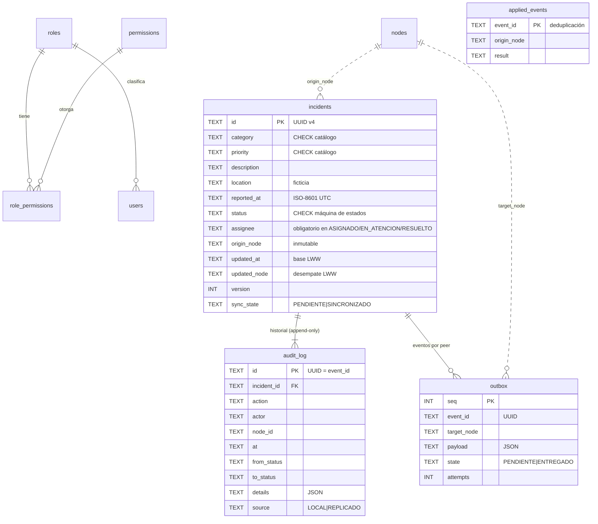

# Fase 3 · Modelo de datos, bitácora y diccionario

- Script DDL: [`src/db/schema.sql`](../src/db/schema.sql). Es idempotente y se aplica en cada arranque.
- Semillas de roles, permisos, usuarios ficticios y nodos: [`src/db/migrate.js`](../src/db/migrate.js), a partir de [`src/domain/rules.js`](../src/domain/rules.js).
- Versión del esquema: `PRAGMA user_version = 3`. La versión 3 agregó `sync_log`.

Cada nodo ejecuta el **mismo esquema** sobre **su propio archivo** (`data/nodeA.db`, `data/nodeB.db`).

## 1. Diagrama entidad-relación



## 2. Diccionario de datos

### `incidents`: estado actual de cada incidente (locales y réplicas)

| Columna | Tipo | Restricciones | Descripción |
|---|---|---|---|
| `id` | TEXT | PK, `length = 36` | UUID v4 generado en el nodo de origen, o enviado por el cliente como clave de idempotencia |
| `category` | TEXT | NOT NULL, CHECK catálogo | INFRAESTRUCTURA, RIESGO_AMBIENTAL, SOLICITUD_APOYO, SERVICIOS_TI, OTRO |
| `priority` | TEXT | NOT NULL, CHECK catálogo | BAJA, MEDIA, ALTA, CRITICA |
| `description` | TEXT | 10–1000 caracteres | Descripción del evento |
| `location` | TEXT | 3–120 caracteres | Ubicación **ficticia** |
| `reported_at` | TEXT | NOT NULL | Cuándo ocurrió o se reportó (ISO-8601 UTC) |
| `status` | TEXT | CHECK de los 7 estados | Estado actual |
| `assignee` | TEXT | Obligatorio si el estado es ASIGNADO, EN_ATENCION o RESUELTO | Responsable ficticio |
| `origin_node` | TEXT | NOT NULL, **inmutable** (trigger) | Nodo donde se registró (partición lógica) |
| `created_by` / `created_at` | TEXT | **Inmutables** | Autor y hora del alta |
| `updated_at` | TEXT | NOT NULL | Última escritura; es la base de Last Write Wins |
| `updated_by` / `updated_node` | TEXT | NOT NULL | Autor y nodo de la última escritura (`updated_node` desempata en LWW) |
| `version` | INTEGER | ≥ 1 | Se incrementa en cada cambio; sirve para el control optimista |
| `sync_state` | TEXT | PENDIENTE \| SINCRONIZADO | Marca de sincronización que se muestra en la UI |
| `last_synced_at` | TEXT | NULL | Última confirmación de sincronización |

Índices: `status`, `priority`, `category`, `origin_node`, `reported_at`. Cubren los filtros de F-02.

### `audit_log`: bitácora append-only (F-04, F-08)

| Columna | Descripción |
|---|---|
| `id` | UUID de la entrada. **Es el mismo UUID del evento replicado** (`event_id`), así que un cambio es una entrada de bitácora y un evento |
| `incident_id` | FK a `incidents` |
| `action` | CREAR, ASIGNAR, TRANSICION, SYNC_CONFLICTO |
| `actor`, `actor_role` | Usuario de prueba y su rol |
| `node_id` | Nodo donde **ocurrió** el cambio |
| `at` | Hora del cambio (UTC) |
| `from_status`, `to_status` | Estado anterior y nuevo |
| `details` | JSON validado (`json_valid`): nota, responsable anterior y nuevo, versión, etc. |
| `source` | LOCAL (ocurrió aquí) o REPLICADO (llegó de un peer) |
| `recorded_at` | Cuándo lo guardó **este** nodo. Permite comparar las bitácoras entre nodos |

Los triggers `trg_audit_no_update` y `trg_audit_no_delete` impiden modificar o borrar entradas, y la prueba T-04 lo verifica.

### `outbox`: cola persistente de salida (F-06)

Tiene una fila por par (evento, nodo destino), con `UNIQUE(event_id, target_node)`. Se escribe **en la misma transacción** que el cambio de negocio (patrón *transactional outbox*). Por eso no puede existir un cambio sin su evento pendiente, ni un evento sin su cambio. El payload lleva la **instantánea completa** del incidente y su entrada de bitácora.

| Columna | Descripción |
|---|---|
| `seq` | Orden de envío (AUTOINCREMENT) |
| `state` | PENDIENTE → ENTREGADO |
| `attempts`, `last_attempt_at`, `last_error` | Diagnóstico de los reintentos |
| `remote_result` | Respuesta del peer: APLICADO, DUPLICADO o CONFLICTO_* |

### `applied_events`: deduplicación en el receptor (F-07)

Clave primaria `event_id`. Si un evento llega de nuevo (reintento o sincronización repetida), se detecta aquí y no se aplica dos veces.

### `sync_log`: bitácora persistente de red y sincronización

Columnas: `id` (autoincremental), `at`, `peer`, `kind` y `detail` (JSON). Registra caídas y recuperaciones de peers, cortes simulados, lotes enviados y recibidos y conflictos. Sobrevive a los reinicios y es la evidencia de T-07, T-08 y T-09. Los tipos están en [SINCRONIZACION.md](SINCRONIZACION.md#5-bitácora-de-red-y-sincronización).

### Seguridad: `roles`, `permissions`, `role_permissions`, `users`

La matriz rol→permiso se siembra desde `rules.js` y **la autorización se consulta en la BD** en cada petición ([`src/middleware/auth.js`](../src/middleware/auth.js)). Los usuarios son personas ficticias:

| Usuario | Rol | Nodo habitual |
|---|---|---|
| `op.norte` | OPERADOR | A |
| `op.sur` | OPERADOR | B |
| `coord` | COORDINADOR | — |
| `auditor` | AUDITOR | — |

### `nodes`, `node_identity`

- `nodes` guarda este nodo y sus peers según `PEERS`.
- `node_identity` es una fila única con el dueño del archivo. Si la base no corresponde al `NODE_ID`, el nodo no arranca.

## 3. Transacciones e integridad

Cada operación de escritura (`create`, `transition`, `assign`) corre en `BEGIN IMMEDIATE … COMMIT` ([`src/db/tx.js`](../src/db/tx.js)) y hace tres cosas: actualiza el incidente, inserta la entrada de bitácora y encola el evento. Si algo falla, se hace `ROLLBACK` y no queda ningún rastro parcial.

| Garantía | Mecanismo |
|---|---|
| Unicidad global sin coordinación | UUID v4 |
| Alta idempotente | El cliente puede enviar `id`. Si se repite, la respuesta es `200` con `idempotentReplay: true` |
| Transiciones válidas | Máquina de estados en el servicio, más un CHECK de estados válidos en la BD |
| Responsable obligatorio | CHECK de tabla |
| Escrituras concurrentes | `UPDATE … WHERE version = ?` (bloqueo optimista) y `expectedVersion` opcional desde el cliente |
| Historial inalterable | Triggers append-only |
| Orden temporal estricto por incidente | `updated_at` siempre es mayor que el anterior, aunque el reloj retroceda |

## 4. Consultas de ejemplo (SQL)

```sql
-- Incidentes por nodo de origen y estado
SELECT origin_node, status, COUNT(*) FROM incidents GROUP BY origin_node, status;

-- Historial de un incidente
SELECT at, action, actor, node_id, from_status, to_status, details
FROM audit_log WHERE incident_id = :id ORDER BY at;

-- Eventos pendientes de enviar por peer (F-06)
SELECT target_node, COUNT(*) FROM outbox WHERE state = 'PENDIENTE' GROUP BY target_node;

-- Integridad: no debe haber entradas de bitácora sin su evento en la outbox
SELECT COUNT(*) FROM audit_log a LEFT JOIN outbox o ON o.event_id = a.id
WHERE a.source = 'LOCAL' AND o.event_id IS NULL;
```

Se pueden ejecutar con cualquier cliente SQLite, por ejemplo `sqlite3 data/nodeA.db` o DB Browser for SQLite.
