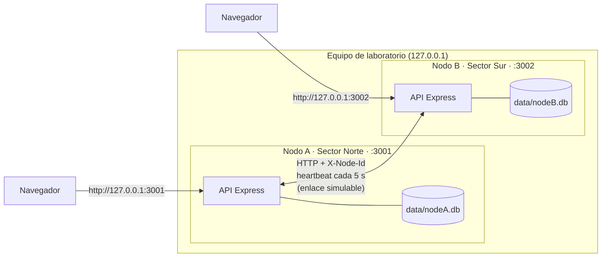

# Fase 2 · Nodos, red y firewall

## 1. Qué es real, qué es virtual y qué es simulado

| Elemento | Naturaleza | Detalle |
|---|---|---|
| Dos nodos A y B | **Real** (procesos independientes) | Dos procesos Node.js distintos, cada uno con su PID, su puerto y su archivo SQLite |
| Comunicación entre nodos | **Real** (TCP/HTTP sobre loopback) | Peticiones HTTP verdaderas entre `127.0.0.1:3001` y `127.0.0.1:3002` |
| Separación física de los datos | **Simulada** | Archivos `.db` separados en un mismo disco; no son máquinas distintas |
| Caída de un nodo (matar el proceso) | **Real** | `scripts/kill-node.ps1` / `.sh` termina el proceso; el peer recibe `ECONNREFUSED` |
| Corte de enlace, latencia, jitter y pérdida | **Simulados por software** | Capa `src/network/netsim.js`, controlada con `/api/admin/links` |
| Dos computadoras (modo LAN, opcional) | **Real** | Nodos en equipos distintos, tráfico por la LAN y firewall real; ver [DESPLIEGUE_DOS_EQUIPOS.md](DESPLIEGUE_DOS_EQUIPOS.md) |
| Topología Mesh/MANET | **Simulada** | Malla completa configurable por `PEERS`; la movilidad se emula cortando y restableciendo enlaces. **No** hay enrutamiento multi-salto real (AODV/OLSR) |

## 2. Topología



**Extensión a malla (Mesh).** Cada nodo lista a sus vecinos en `PEERS`. Con tres nodos se tiene una malla completa, por ejemplo:

```
A: PEERS=B=http://127.0.0.1:3002,C=http://127.0.0.1:3003
B: PEERS=A=http://127.0.0.1:3001,C=http://127.0.0.1:3003
C: PEERS=A=http://127.0.0.1:3001,B=http://127.0.0.1:3002
```

**Emulación MANET.** En una MANET los enlaces aparecen y desaparecen porque los nodos se mueven. Aquí eso se emula por enlace con `PUT /api/admin/links/:peer`: se corta el enlace (fuera de alcance de radio), se le sube la latencia o se le añade pérdida (señal débil). El heartbeat detecta cada cambio y lo registra como `PEER_DOWN` / `PEER_UP` en `/api/network/events`.

## 3. Tabla de nodos, direcciones y puertos

| Nodo | Sector | Interfaz (`HOST`) | Puerto TCP | Base de datos | Archivo de configuración |
|---|---|---|---|---|---|
| A | Sector Norte | 127.0.0.1 | 3001 | `data/nodeA.db` | `config/nodeA.env` |
| B | Sector Sur | 127.0.0.1 | 3002 | `data/nodeB.db` | `config/nodeB.env` |

Variables de cada nodo (ver [`.env.example`](../.env.example)): `NODE_ID`, `NODE_NAME`, `HOST`, `PORT`, `DB_PATH`, `PEERS`, `PEER_TIMEOUT_MS` (1500), `HEARTBEAT_MS` (5000).

### Despliegue en dos computadoras de una LAN de laboratorio

Guía completa paso a paso: **[DESPLIEGUE_DOS_EQUIPOS.md](DESPLIEGUE_DOS_EQUIPOS.md)**. En resumen:
1. `scripts/setup-lan.ps1` genera en cada equipo `config/nodeX.local.env` (con `HOST=0.0.0.0` y `PEERS` apuntando a la IP del otro equipo) y crea la regla de firewall.
2. Se arranca con `npm run start:lan:a` / `start:lan:b`.

En esta modalidad, los nodos y la red entre ellos son **reales**. La caída se puede provocar desconectando el Wi-Fi o el cable, o con una regla de bloqueo del firewall (`setup-lan.ps1 -BloquearPeer`). Mesh/MANET sigue siendo simulado.

Las rutas `/api/admin/*` siguen aceptando solo peticiones desde la propia máquina (loopback), aunque el nodo escuche en todas las interfaces. Se verificó el 2026-11-18: una llamada a la IP LAN del equipo respondió `403 ADMIN_LOCAL_ONLY` y la misma llamada por `127.0.0.1` fue aceptada.

| Equipo | Nodo | IP LAN | Puerto | Configuración |
|---|---|---|---|---|
| 1 | A | *(completar)* | 3001 | `config/nodeA.local.env` |
| 2 | B | *(completar)* | 3002 | `config/nodeB.local.env` |

## 4. Firewall

Política: **denegar por defecto**. Solo se abre el puerto del nodo, y solo hacia la subred del laboratorio. Con `HOST=127.0.0.1`, que es el valor por defecto, el puerto ni siquiera se ve desde la red y no hace falta ninguna regla.

**Windows (PowerShell como administrador):**
```powershell
# Permitir el nodo A solo desde la subred local del laboratorio
New-NetFirewallRule -DisplayName "Lab2 Nodo A (3001)" -Direction Inbound -Protocol TCP -LocalPort 3001 -RemoteAddress LocalSubnet -Action Allow -Profile Private
# Verificar
Get-NetFirewallRule -DisplayName "Lab2*" | Format-Table DisplayName, Enabled, Action
# Retirar al terminar la práctica
Remove-NetFirewallRule -DisplayName "Lab2 Nodo A (3001)"
```

**Linux (ufw):**
```bash
sudo ufw default deny incoming
sudo ufw allow from 192.168.56.0/24 to any port 3002 proto tcp comment 'Lab2 Nodo B'
sudo ufw status numbered
```

Justificación:
- Se usa el perfil *Private* / la subred del laboratorio para que el servicio nunca quede expuesto a Internet (sección 10 del documento del laboratorio).
- Se abre solo TCP y solo el puerto del nodo.
- Las reglas se retiran al terminar.

## 5. Pruebas de conectividad (evidencia)

Con ambos nodos levantados (`npm run start:all`):

```bash
npm run net:test
```

El script mide dos cosas: **cliente → nodo** (`/api/health`) y **nodo → nodo** (`/api/network/probe`, que pasa por la capa de red simulada). Guarda el JSON de la medición en `docs/evidencias/`.

Resultados observados el 2026-11-13 (Windows 11, Node 24.14, mismo equipo):

| Prueba | Envíos | OK | Pérdida | Latencia mín / prom / máx |
|---|---|---|---|---|
| A → B, enlace normal | 20 | 20 | 0 % | 1.46 / 2.50 / 4.23 ms |
| B → A, enlace normal | 20 | 20 | 0 % | 1.20 / 2.02 / 4.51 ms |
| A → B, latencia 150 ms + jitter 30 ms + pérdida 30 % (simulado) | 10 | 6 | 40 % | 162.7 / 171.7 / 181.4 ms |
| A → B, enlace cortado (simulado) | 2 | 0 | 100 % | — (`LINK_DOWN_SIMULATED`) |
| B → A, con A rechazando a B (partición simétrica) | 2 | 0 | 100 % | — (`LINK_DOWN_SIMULATED`) |
| A → B, proceso B terminado (real) | 2 | 0 | 100 % | — (`CONNECTION_REFUSED`) |

La pérdida observada (40 %) es mayor que la configurada (30 %) porque la muestra es pequeña (10 envíos).

Motivos de fallo que reporta la capa de red: `LINK_DOWN_SIMULATED`, `PACKET_LOSS_SIMULATED`, `TIMEOUT`, `CONNECTION_REFUSED`, `HTTP_ERROR`, `NETWORK_ERROR`.

## 6. Procedimiento seguro de desconexión y reconexión

### Modo 1: caída real del nodo (proceso)

```powershell
# Terminal 1 y 2: levantar cada nodo por separado
npm run start:a
npm run start:b
# Terminal 3: tirar el nodo B
.\scripts\kill-node.ps1 -Port 3002          # Linux/macOS: ./scripts/kill-node.sh 3002
# Observar en A
Invoke-RestMethod http://127.0.0.1:3001/api/network/peers     # B -> offline, CONNECTION_REFUSED
# Reconectar
npm run start:b
Invoke-RestMethod http://127.0.0.1:3001/api/network/events    # PEER_DOWN ... PEER_UP
```

### Modo 2: corte de enlace simulado (los nodos siguen vivos)

```powershell
$h = @{ 'Content-Type' = 'application/json' }
# Cortar A<->B (A deja de llamar a B y además rechaza las peticiones de B: partición simétrica)
Invoke-RestMethod -Method Put http://127.0.0.1:3001/api/admin/links/B -Headers $h -Body '{"up":false}'
# Enlace degradado (MANET: señal débil)
Invoke-RestMethod -Method Put http://127.0.0.1:3001/api/admin/links/B -Headers $h -Body '{"up":true,"latencyMs":150,"jitterMs":30,"lossRate":0.3}'
# Aislar el nodo de todos sus vecinos y después reintegrarlo
Invoke-RestMethod -Method Post http://127.0.0.1:3001/api/admin/isolate -Headers $h -Body '{"isolated":true}'
Invoke-RestMethod -Method Post http://127.0.0.1:3001/api/admin/isolate -Headers $h -Body '{"isolated":false}'
```

Las dos formas son seguras: no tocan adaptadores de red ni la configuración del sistema operativo. El estado simulado vive en memoria y se reinicia al reiniciar el nodo.

## 7. Diagnóstico rápido

| Síntoma | Causa probable | Acción |
|---|---|---|
| `el puerto 3001 ya está en uso` | Quedó un proceso anterior | `.\scripts\kill-node.ps1 -Port 3001` |
| `El archivo ... pertenece al nodo A, no a B` | `DB_PATH` apunta a la base de otro nodo | Corregir `DB_PATH` en `config/nodeB.env` |
| El peer aparece `offline` con `LINK_DOWN_SIMULATED` | El enlace quedó cortado en la simulación | `PUT /api/admin/links/<peer>` con `{"up":true}` o reiniciar el nodo |
| `ADMIN_LOCAL_ONLY` | Se llamó a `/api/admin/*` desde otra máquina | Ejecutarlo en la máquina del nodo |
