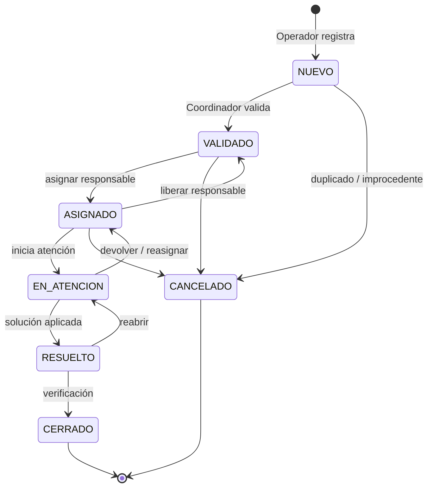

# Fase 1 · Análisis y reglas del prototipo

> **Aviso:** este es un prototipo académico (UNACH, Cómputo distribuido RE04, Laboratorio Integrador 02).
> **No** es un servicio real de emergencias ni sustituye a los canales oficiales. Todas las personas, ubicaciones y datos son ficticios.

La implementación de estas reglas está en [`src/domain/rules.js`](../src/domain/rules.js), que es la única fuente de verdad. La API, la interfaz y esta documentación usan las mismas constantes.

## 1. Alcance y límites

| Incluido | Fuera de alcance (límites declarados) |
|---|---|
| Registro, consulta y filtrado de incidentes (F-01, F-02) | Notificaciones push, SMS o correo reales |
| Flujo de estados con bitácora (F-03, F-04, F-08) | Autenticación con contraseñas o SSO real (se usan usuarios de prueba) |
| Dos nodos con base SQLite propia y una consulta agregada (F-05) | Enrutamiento multi-salto real de una red MANET (se simula, ver [RED_MESH_MANET.md](RED_MESH_MANET.md)) |
| Cola persistente durante la desconexión y sincronización al reconectar (F-06, F-07) | Consenso fuerte (Raft/Paxos) y transacciones distribuidas 2PC |
| Interfaz web responsiva (F-09) | Despliegue público en Internet |

## 2. Actores y roles

| Rol | Persona de prueba (ficticia) | Responsabilidad |
|---|---|---|
| **Operador** | Registra incidentes desde un sector | Crear incidentes y consultarlos |
| **Coordinador** | Valida, asigna responsables y cambia estados | Gestionar el ciclo de vida |
| **Auditor** | Revisa el historial | Consultar la bitácora y el estado de sincronización (solo lectura) |

### Matriz de permisos

| Permiso | Operador | Coordinador | Auditor |
|---|:-:|:-:|:-:|
| `incident:create` (registrar) | ✔ | ✔ | — |
| `incident:read` (consultar y filtrar) | ✔ | ✔ | ✔ |
| `incident:assign` (asignar responsable) | — | ✔ | — |
| `incident:transition` (cambiar estado) | — | ✔ | — |
| `audit:read` (bitácora) | — | ✔ | ✔ |
| `sync:status` (estado de sincronización) | — | ✔ | ✔ |

Las operaciones administrativas de infraestructura (simular cortes de enlace, respaldos) no son un rol de negocio. Solo se permiten desde la propia máquina del nodo (loopback), por privilegio mínimo.

## 3. Catálogos

**Categorías:** `INFRAESTRUCTURA` (Infraestructura), `RIESGO_AMBIENTAL` (Riesgo ambiental), `SOLICITUD_APOYO` (Solicitud de apoyo), `SERVICIOS_TI` (Servicios de TI), `OTRO` (Otro).

**Prioridades**: siempre se muestran con texto, no solo con color (requisito de usabilidad):

| Código | Etiqueta | Orden |
|---|---|---|
| `BAJA` | Baja | 1 |
| `MEDIA` | Media | 2 |
| `ALTA` | Alta | 3 |
| `CRITICA` | Crítica | 4 |

## 4. Ciclo de vida (máquina de estados)

| Estado actual | Destinos válidos | Quién |
|---|---|---|
| Nuevo | Validado, Cancelado | Coordinador |
| Validado | Asignado (requiere responsable), Cancelado | Coordinador |
| Asignado | En atención, Validado, Cancelado | Coordinador |
| En atención | Resuelto, Asignado | Coordinador |
| Resuelto | Cerrado, En atención | Coordinador |
| Cerrado / Cancelado | — (terminales) | — |

Reglas:
- Cualquier transición que no esté en la tabla se rechaza con `409 INVALID_TRANSITION` y **no modifica** el estado (T-03).
- Cada transición válida genera un registro en la bitácora con actor, hora, nodo, estado anterior y estado nuevo (T-04).
- Pasar a `ASIGNADO` exige un responsable ficticio (F-04).

## 5. Datos distribuidos y trazabilidad

**Distribución por nodo de origen.** Cada incidente nace en un nodo y guarda `origin_node`, que no cambia nunca. Los cambios se replican de forma asíncrona a los demás nodos, así que la consistencia es **eventual**. Cada nodo tiene su propio archivo SQLite (`data/nodeA.db`, `data/nodeB.db`), y ese archivo guarda su identidad en la tabla `node_identity`. Por eso un nodo se niega a arrancar si se le asigna la base de otro.

El esquema definitivo está en [`src/db/schema.sql`](../src/db/schema.sql) y el diccionario de datos en [MODELO_DATOS.md](MODELO_DATOS.md). Resumen:

| Entidad | Campos clave de trazabilidad |
|---|---|
| `incidents` | `id` (UUID), `category`, `priority`, `description`, `location`, `reported_at`, `status`, `assignee`, `origin_node`, `created_by`, `created_at`, `updated_at`, `updated_by`, `updated_node`, `version`, `sync_state` |
| `audit_log` | `id` (UUID), `incident_id`, `action`, `actor`, `actor_role`, `node_id`, `at`, `from_status`, `to_status`, `details` (JSON), `source` (`LOCAL` / `REPLICADO`), `recorded_at` |
| `outbox` (cola persistente) | `seq`, `event_id` (UUID = id de la bitácora), `target_node`, `incident_id`, `event_type`, `payload`, `created_at`, `state` (`PENDIENTE` / `ENTREGADO`), `attempts`, `last_error`, `remote_result` |
| `applied_events` | `event_id` (UUID), `origin_node`, `incident_id`, `received_at`, `result` (`APLICADO` / `CONFLICTO_GANA_LOCAL` / `CONFLICTO_GANA_REMOTO`) |

## 6. Identificadores, tiempo, duplicados y conflictos

| Decisión | Regla | Justificación |
|---|---|---|
| ID de incidente | UUID v4 generado **en el nodo de origen** (`crypto.randomUUID()`) | No hace falta coordinarse con otro nodo para crear un incidente, incluso desconectado |
| ID de evento | UUID v4 por cada cambio que se replica | Hace idempotente la sincronización |
| Marcas de tiempo | ISO-8601 en UTC (`2026-11-13T04:42:30.815Z`) | Se pueden comparar entre nodos sin ambigüedad de zona horaria |
| Duplicados | El receptor registra cada `event_id` aplicado. Si llega uno repetido, se responde `duplicado` sin efecto | Reintentar la sincronización no duplica registros (F-07, T-08) |
| Conflictos | **Last Write Wins** por `updated_at`. En empate gana el `node_id` mayor lexicográficamente. La versión perdedora se anota en la bitácora como `conflicto` | Es determinista y todos los nodos convergen al mismo valor (T-09) |

**Limitación declarada:** LWW depende de los relojes. En este prototipo los dos nodos corren en la misma máquina, con el mismo reloj, así que no hay desfase. En un despliegue real habría que sincronizar los relojes con NTP o usar relojes lógicos híbridos (HLC). Además, LWW descarta la escritura perdedora; por eso queda registrada en la bitácora, para que se pueda auditar.

## 7. Resiliencia: qué funciona sin conexión

| Función | Con el peer caído |
|---|---|
| Registrar, consultar, asignar y cambiar estado de incidentes **locales** | Disponible: los cambios se encolan en `outbox` |
| Ver incidentes del peer ya replicados | Disponible, marcados con su última sincronización |
| Consulta agregada en vivo | **Parcial**: responde con `complete: false` e identifica el nodo que no respondió (T-06) |
| Modificar un incidente cuyo origen es el peer | Disponible sobre la réplica local; se resuelve con LWW al reconectar (T-09) |

## 8. Contrato de API (previo)

| Método y ruta | Descripción | Bloque |
|---|---|---|
| `GET /api/health` | Identidad del nodo y estado de su SQLite | **1 ✔** |
| `GET /api/network/peers` | Estado observado de cada peer (heartbeat) | **1 ✔** |
| `GET /api/network/probe?count=N` | Mide latencia y fallos hacia cada peer | **1 ✔** |
| `GET /api/network/events` | Bitácora de red (peer caído o recuperado, enlaces simulados) | **1 ✔** |
| `PUT /api/admin/links/:peer` | Simulación: cortar o restablecer el enlace, latencia, pérdida (solo loopback) | **1 ✔** |
| `POST /api/admin/isolate` | Simulación: aislar el nodo de todos sus peers (solo loopback) | **1 ✔** |
| `GET /api/catalogs` · `GET /api/users` · `GET /api/me` | Catálogos, usuarios de prueba y matriz de permisos | **2 ✔** |
| `POST /api/incidents` | Registrar (F-01) | **2 ✔** |
| `GET /api/incidents?status=&priority=&category=&node=&from=&to=&q=` | Consultar y filtrar (F-02) | **2 ✔** |
| `GET /api/incidents/:id` | Detalle con historial (F-02, F-08) | **2 ✔** |
| `POST /api/incidents/:id/assign` | Asignar responsable (F-04) | **2 ✔** |
| `POST /api/incidents/:id/transition` | Cambiar estado (F-03) | **2 ✔** |
| `GET /api/audit` | Bitácora (F-08) | **2 ✔** |
| `GET /api/aggregate/incidents` | Consulta agregada multinodo (F-05) | **3 ✔** |
| `POST /api/sync/receive` · `POST /api/sync/run` · `GET /api/sync/status` · `GET /api/sync/log` | Sincronización y bitácora de red (F-06, F-07) | **3 ✔** |

## 9. Plan de pruebas

| ID | Prueba | Bloque | Método |
|---|---|---|---|
| T-01 | Registro | 2 | Automática (`npm test`) y manual |
| T-02 | Validación | 2 | Automática |
| T-03 | Transición | 2 | Automática |
| T-04 | Auditoría | 2 | Automática |
| T-05 | Consulta distribuida | 3 | Automática con los 2 nodos |
| T-06 | Nodo no disponible | 3 | Matar el proceso B y repetir la consulta |
| T-07 | Desconexión | 3 | Enlace simulado y caída real |
| T-08 | Sincronización | 3 | Reconectar y reintentar (idempotencia) |
| T-09 | Conflicto | 3 | Editar el mismo incidente en A y B estando aislados |
| T-10 | Restauración | 5 | Script de respaldo y restauración del `.db` |
| T-11 | Responsividad | 4 | Manual (móvil 375 px y escritorio) |
| T-12 | Seguridad | 2–5 | Permisos por rol, validación, revisión de secretos |

Cada prueba se documentará en `docs/PRUEBAS.md` con precondiciones, pasos, resultado esperado, resultado observado, evidencia y conclusión.
